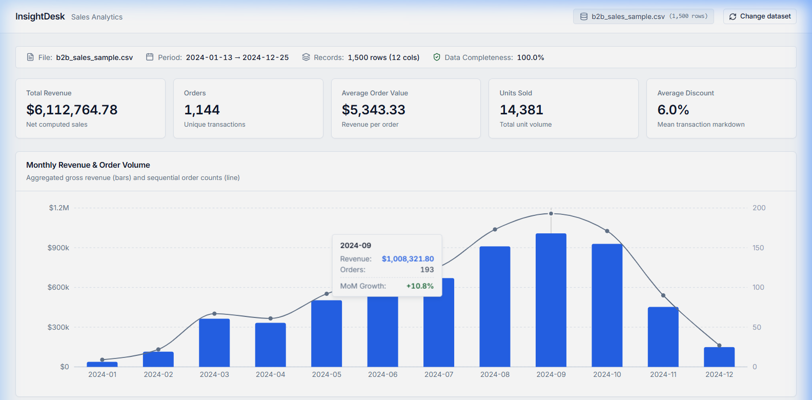

# InsightDesk

A sales analytics dashboard with a FastAPI/Pandas backend, a React/TypeScript interface and optional AI explanations of computed summaries.

**Python calculates; AI explains.**

[Portfolio case study](https://www.youssefmanssouri.site/projects/insightdesk) · [Analytics engine](backend/services/analytics_engine.py) · [Backend tests](backend/tests)

The screenshot uses the bundled synthetic sales dataset. Its revenue figures illustrate the dashboard and are not business results.

## What I built

- CSV upload and sample-data analysis with revenue, orders, average order value and units sold.
- Monthly trends, product rankings, regional comparisons and data-quality reports.
- Structured FastAPI responses consumed by a React/Recharts dashboard.
- An optional Gemini analyst that receives computed summaries rather than raw CSV transaction rows.

## Architecture and evidence

~~~mermaid
flowchart LR
    CSV[Sales CSV] --> API[FastAPI validation and sanitization]
    API --> Pandas[Pandas calculations and profiling]
    Pandas --> Contract[Structured analysis response]
    Contract --> UI[React dashboard]
    Contract --> Context[Computed summary context]
    Context --> AI[Optional Gemini explanation]
    AI --> UI
~~~

| Concern | Source |
| --- | --- |
| Metric calculations | [Analytics engine](backend/services/analytics_engine.py) |
| Missing values and data profiling | [Profiler](backend/services/data_profiler.py) |
| Upload limits, dataset selection and API handlers | [FastAPI entry point](backend/main.py) |
| AI context and response handling | [AI analyst](backend/services/ai_analyst.py) |
| Backend response contract | [Pydantic schemas](backend/models/schemas.py) |
| Frontend response contract | [TypeScript types](frontend/src/types/analytics.ts) |

## Technical decisions

| Challenge | Decision | Trade-off |
| --- | --- | --- |
| Keep dashboard arithmetic reproducible | Calculate metrics in Python before building the AI context | The analytics layer must define the meaning of each metric explicitly |
| Limit what is sent to the model | Construct the prompt from computed summaries | Summaries still contain dataset-derived information, and generated prose needs review |
| Support dataset switching without a database | Store analysis responses in a bounded, process-local cache keyed by dataset ID | Sessions disappear on restart and are not user-authentication boundaries |

## Run locally

You need Python 3.10+ and Node.js 20+ with npm. No AI key is required to explore the analytics dashboard.

From the repository root:

~~~sh
python -m venv .venv
~~~

Activate it with `.venv\Scripts\Activate.ps1` on Windows PowerShell, or `source .venv/bin/activate` on macOS/Linux. Then start the backend:

~~~sh
python -m pip install -r backend/requirements.txt
python -m uvicorn main:app --app-dir backend --host 127.0.0.1 --port 8000
~~~

In a second terminal:

~~~sh
cd frontend
npm ci
npm run dev -- --host 127.0.0.1
~~~

Open [localhost:5173](http://127.0.0.1:5173). The [Vite development proxy](frontend/vite.config.ts) forwards the API and health routes to port 8000. Load the sample dataset to explore the dashboard.

### Optional AI configuration

[backend/.env.example](backend/.env.example) lists the supported variables. The [configuration module](backend/core/config.py) reads process environment variables; it does not automatically load an `.env` file.

To enable the analyst, set `GEMINI_API_KEY` in the backend terminal before starting it. `GEMINI_MODEL` can override the configured model. Keep the key out of source control. With no key, the calculation dashboard remains available and the analyst reports its configuration state.

## API

| Method | Route | Purpose |
| --- | --- | --- |
| GET | /health | Backend and active-dataset status |
| GET | /api/ai/status | Analyst configuration status |
| POST | /api/sample | Analyze bundled synthetic data |
| POST | /api/upload | Analyze an uploaded CSV |
| POST | /api/ask | Ask about an analysis using its dataset ID |

The upload handler accepts CSV files up to 25 MiB and requires at least five rows. Use the bundled [sample CSV](backend/sample_data/b2b_sales_sample.csv) as the supported sales schema reference.

## Checks

With the Python environment active:

~~~sh
python -m pytest backend/tests -v
~~~

The four `test_*.py` modules include **28 tests** covering calculations, ingestion, dataset selection and mocked AI responses. This is the included test count, not a live CI result.

~~~sh
cd frontend
npm run build
~~~

The build script checks TypeScript and creates the Vite bundle.

## Current limits

- The cache is capped at 50 analysis sessions and evicts the oldest inserted entry. It is not an LRU cache.
- An omitted dataset ID uses the process's latest active analysis. The application is a single-process prototype, without per-user authenticated dataset storage.
- AI prompts use computed summaries, but the current fact-cleaning helper only trims and filters short text; it does not independently verify numerical claims in generated prose.
- The Vite proxy is a development configuration. Hosted frontend/API routing needs its own configuration.

[Data-quality screenshot](docs/images/data-quality.png) · [Portfolio](https://www.youssefmanssouri.site)
